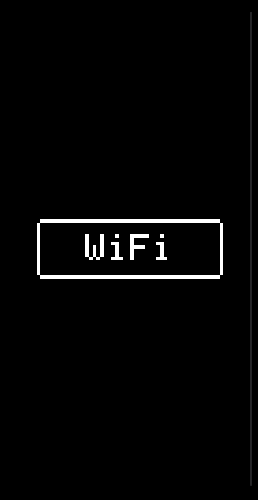

# Weather Display App
  
This is a real-time weather and time display app for the device32 (ESP32-based board with OLED display). It shows current weather conditions and local time.

## Requirements
- device32 hardware (ESP32-based with OLED display)
- PlatformIO development environment
- USB connection for flashing
- WiFi network for internet access

## Configuration
WiFi is **not** configured in code — the device provisions itself (see below).
The only thing worth editing is the location, at the top of `src/main.cpp`:

- **Location**:
  ```cpp
  const float latitude = 41.2565;
  const float longitude = -95.9345;
  ```

## Setup
1. Open this folder (`examples/weather/`) in VSCode with PlatformIO installed.
2. Connect your device32 via USB.
3. Use PlatformIO to build and upload the project (`pio run --target upload`).
4. On first boot, follow the WiFi setup below.

## WiFi setup (first boot)
The firmware ships with no credentials, so the first boot (or any boot with no
saved network) raises a configuration hotspot:

1. On a phone or laptop, join the WiFi network **`device32-weather`**.
2. A captive-portal page usually opens by itself. If not, browse to
   **http://192.168.4.1/**.
3. Pick your network from the scanned list (or type its SSID), enter the
   password, and tap **Save & connect**.
4. The device stores the credentials in NVS and connects. Later boots reconnect
   on their own.

To forget the network, hold the button for about 4 seconds: the display shows
`WiFi reset` and the device reboots back into setup.

## Usage
- Power on the device. Once it has WiFi (see the setup above) it connects, detects the timezone from your IP, and starts displaying weather and time.
- The display shows:
  - Current time in HH:MM format (e.g., "13:03")
  - Current date (e.g., "Dec 8")
  - Weather description (e.g., "Clear sky")
  - Temperature in Fahrenheit (e.g., "45 F")
- No user controls needed; it's fully automatic.

## Notes
- Weather data is fetched from Open-Meteo (free, open-source).
- Timezone is auto-detected via IP geolocation; ensure your network allows outbound HTTP requests.
- If weather fails to load, check WiFi connection and serial output for errors.
- Power consumption is low; suitable for continuous operation.